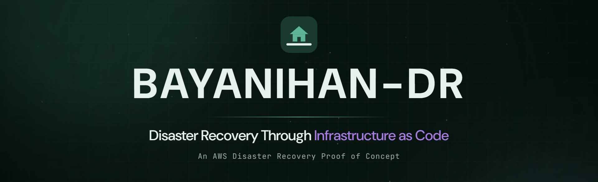
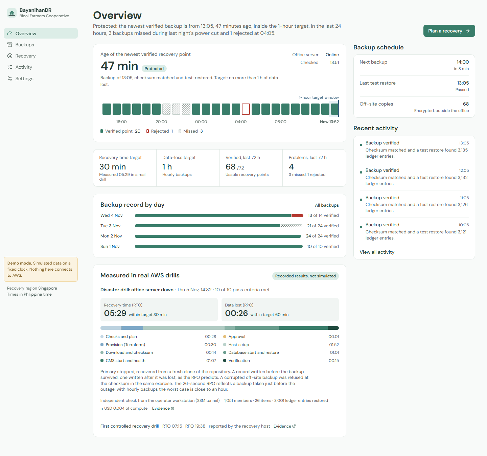
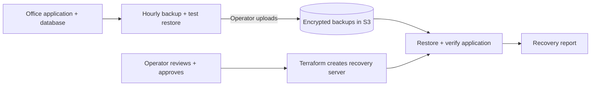

# BayanihanDR



[](https://github.com/jervilangelo/bayanihan-dr/actions/workflows/ci.yml)
[](https://github.com/jervilangelo/bayanihan-dr/actions/workflows/public-site.yml)

**Recover a small business application in AWS when its office server goes offline.**

BayanihanDR is a disaster recovery proof of concept for Philippine small businesses. It protects a sample management system for the fictional **Bicol Farmers Cooperative**, which stores member, inventory, and financial records.

If a typhoon takes the office server offline, BayanihanDR uses Terraform to create a temporary recovery server in AWS Singapore (`ap-southeast-1`), restore a verified backup, and check that the application works again.

**[Try the live demo](https://jervilangelo.github.io/bayanihan-dr/)** · **[Browse the documentation](docs/README.md)**

The public demo uses simulated data and recovery steps, alongside published results from real AWS drills. It does not connect to AWS or create resources. All project data is synthetic.



## How it works

1. **Back up the database every hour.** Each backup is restored into a temporary test database to check that it can be recovered.
2. **Copy verified backups to AWS S3.** Encrypted, off-site copies remain available if the office server is lost. Uploads currently require an operator session.
3. **Review and approve recovery.** A local job runner checks the backup and Terraform plan. The operator approves the job before AWS resources are created.
4. **Restore and verify.** The recovery server checks the backup's checksum, restores the database, and checks application health and record counts.
5. **Measure recovery.** The workflow reports recovery time and potential data loss. The operator can then tear down temporary recovery resources.



See the [architecture guide](docs/ARCHITECTURE.md) for the full design.

## Recovery results

| Real AWS drill | Time to recover (RTO) | Potential data loss (RPO) | Evidence |
|---|---|---|---|
| Final disaster drill | **5 min 29 sec** | **26 sec** | [10/10 checks passed](docs/evidence/phase7-disaster-drill.md) |
| First recovery drill | 7 min 15 sec | 19 min 38 sec | [Drill report](docs/evidence/phase6-recovery-drill.md) |
| Project target | Within 30 min | Within 60 min | [Blueprint](docs/MASTER_BLUEPRINT.md) |

**RTO** measures the time from declaring an outage to verifying the restored system. **RPO** measures how far back the recovered data is from the time of the outage.

These are individual test runs on a small synthetic dataset, rather than production guarantees. The 26-second result used a backup taken just before the outage. Because off-site uploads require an operator session, actual data loss depends on the latest uploaded backup. See [limitations and next steps](docs/LESSONS-LEARNED.md#open-items-in-priority-order).

## Try it locally

### Dashboard demo

You need Git, Node.js, and npm. No AWS account is needed.

```powershell
git clone https://github.com/jervilangelo/bayanihan-dr.git
cd bayanihan-dr/frontend
npm ci
npm run dev
```

Open [localhost:5173/bayanihan-dr/](http://localhost:5173/bayanihan-dr/) to explore the dashboard and simulated recovery.

### Sample application and backups

You also need Docker Desktop running. From the repository root:

```powershell
cd cooperative-system
docker compose up -d --build --wait
docker compose exec -T api python -m app.seed
docker compose --profile backup up -d --build
```

Open the sample application's [API documentation](http://localhost:8000/docs). The backup service creates and verifies backups every hour.

To view real local backup status, run this in a second terminal from the repository root:

```powershell
cd frontend
npm ci
npm run dev:ops
```

Real AWS recovery jobs also need the backend job runner and AWS configuration. Follow the [setup guide](docs/SETUP.md) and [operations runbook](docs/RUNBOOK.md) before running a drill.

## Project structure

| Folder | Purpose | Main tools |
|---|---|---|
| [`cooperative-system/`](cooperative-system/README.md) | Sample application: members, inventory, and ledger | FastAPI, PostgreSQL 16, Docker Compose |
| [`backend/`](backend/README.md) | Backup verification, off-site uploads, and recovery jobs | Python |
| [`terraform/`](terraform/README.md) | Standby infrastructure and temporary recovery resources | Terraform, AWS |
| [`frontend/`](frontend/README.md) | Public demo and local operations dashboard | React, TypeScript, Vite |
| [`docs/`](docs/README.md) | Setup, operations, design decisions, and drill evidence | Markdown |

## Security and cost

- AWS access uses temporary credentials rather than long-lived access keys.
- The office server's upload role can add backups, but cannot read or delete them.
- Backups in S3 are encrypted and versioned.
- The recovery server has no inbound ports; administration uses AWS Systems Manager.
- Terraform plans are checked before the operator approves recovery.
- CI runs without cloud credentials.

At project completion on **5 November 2026**, all 10 phases were complete. The recorded standby environment kept backup storage and supporting AWS resources deployed, with no servers running. Recorded project compute spending was about **USD 0.01**, plus a small S3 charge. See the [cost breakdown](docs/COST.md) for assumptions and billing evidence, and the [security guide](docs/SECURITY.md) for controls and accepted risks.

## Testing

CI covers application and database rules, backup integrity and restore checks, recovery approvals, Terraform, and the dashboard. Browser tests cover desktop and phone layouts, accessibility, and external-request checks. The deployed public site also has scheduled checks.

Find test commands in the [component guides](docs/README.md#component-guides) and recovery test results in the [evidence index](docs/README.md#drill-and-deployment-evidence).

## Learn more

- [Setup](docs/SETUP.md): build the full environment from scratch.
- [Runbook](docs/RUNBOOK.md): run backups, drills, recovery, and teardown.
- [Architecture](docs/ARCHITECTURE.md): understand the components and data flows.
- [Lessons learned](docs/LESSONS-LEARNED.md): review limitations and improvements.
- [All documentation](docs/README.md): find decisions, costs, security details, and evidence.
