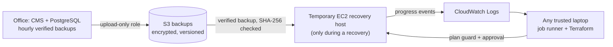

# BayanihanDR

[](https://github.com/jervilangelo/bayanihan-dr/actions/workflows/ci.yml)
[](https://github.com/jervilangelo/bayanihan-dr/actions/workflows/public-site.yml)

**Terraform-powered disaster recovery for Philippine small businesses.** A portfolio proof of concept: when a
typhoon takes the fictional Bicol Farmers Cooperative's office server offline, BayanihanDR rebuilds its Cooperative
Management System in AWS (Singapore, `ap-southeast-1`) from verified, encrypted off-site backups, and measures how
long the recovery actually took.

**Live demo:** https://jervilangelo.github.io/bayanihan-dr/ (static, simulated data plus the real measured results; it never contacts AWS)


## Status

**All 10 phases complete (2026-11-05).** The AWS **standby** environment stays deployed on purpose: an encrypted
backup bucket, IAM roles, a log group and a budget alert, costing pennies per month. No servers are running.

| Measured result (real AWS drills) | RTO | RPO | Evidence |
|---|---|---|---|
| **Phase 7 disaster drill:** office server stopped, recovery from a fresh clone, independently verified, corrupted backup refused | **5 min 29 s** | **26 s** | [report](docs/evidence/phase7-disaster-drill.md) (10/10 criteria) |
| Phase 6 first controlled drill | 7 min 15 s | 19 min 38 s | [report](docs/evidence/phase6-recovery-drill.md) |
| Targets (blueprint §5) | 30 min | 60 min | n/a |

These are single runs on a small synthetic dataset, not guarantees. The 26-second RPO reflects a backup taken just
before the outage. **Main open item:** off-site upload still needs an operator session, so in practice the RPO depends
on someone running `upload --all` (see [open items](docs/LESSONS-LEARNED.md#open-items-in-priority-order)).

Total AWS spend for the whole project so far: **about USD 0.01 for compute, plus fractions of a cent for S3**
([COST.md](docs/COST.md)).

## How it works

| System | Folder | What it does |
|---|---|---|
| **A. Cooperative Management System** | [`cooperative-system/`](cooperative-system/) | FastAPI + PostgreSQL 16 on Docker Compose: members, inventory, ledger. Synthetic data. |
| **B. Recovery engine** | [`backend/`](backend/), [`terraform/`](terraform/) | **`bdr_engine`:** hourly snapshot-consistent backups, each test-restored and recounted before it counts as verified; retention; upload-only off-site copies to S3. **`bdr_runner`:** a local, token-protected job runner (preflight → Terraform plan → fail-closed plan guard → typed approval → apply → host restores itself → RTO/RPO report → teardown). **Terraform:** five modules, a standby/drill switch, S3 state with native locking. |
| **C. Dashboard** | [`frontend/`](frontend/) | React + Vite + TypeScript. **Demo mode** on GitHub Pages: simulated data, an interactive simulated recovery, and the published real results. **Operations mode** locally: real backups and real recovery jobs. |



More: [ARCHITECTURE.md](docs/ARCHITECTURE.md) (diagrams, data flows, trust boundaries).

## Security in brief

- No long-lived AWS keys anywhere; SSO sessions last 4 h.
- The office server can only *add* backups, never read or delete them.
- The recovery host has **no inbound ports**: access through SSM only, and IMDSv2 is required.
- The operator policy denies NAT gateways, load balancers, RDS, EKS, IAM users and other regions.
- CI has no cloud credentials, and its actions are pinned to commit SHAs.
- The public site is static and sanitized, and is tested to make zero external requests.

Details: [SECURITY.md](docs/SECURITY.md).

## Quick start (local, no AWS needed)

```bash
cd cooperative-system
docker compose up -d --build --wait && docker compose exec -T api python -m app.seed   # CMS on 127.0.0.1:8000
docker compose --profile backup up -d --build                                           # hourly verified backups
cd ../frontend && npm ci && npm run dev        # demo dashboard: http://localhost:5173/bayanihan-dr/
npm run dev:ops                                # operations mode: real local backups
```

AWS setup, drills and real recoveries: [SETUP.md](docs/SETUP.md) and [RUNBOOK.md](docs/RUNBOOK.md).

## Tests

| Suite | Count | Runs in |
|---|---|---|
| CMS (FastAPI + PostgreSQL) | pytest | CI, `docker compose --profile test run --rm -T tests` |
| Backup engine (incl. corruption, truncation, tampering, missing manifests) | 41 | CI, `--profile backup-test` |
| Job runner (state machine, plan guard, auth, origin/host checks) | 20 | CI, `backend/runner_tests` |
| Terraform (`terraform test`, mocked provider) + TFLint + Trivy + ShellCheck | 16 | CI |
| Dashboard unit (Vitest) | 45 | CI |
| Dashboard e2e (Playwright: desktop + phone, axe, no external requests) | 50 | CI |
| Live public site (Playwright) | 16 | after each deploy + weekly |

## Documentation

Everything is indexed in **[docs/README.md](docs/README.md)**:
- architecture, runbook, setup from scratch;
- security, cost, lessons learned;
- decisions (ADR-001 to ADR-016), changelog;
- the original blueprint;
- the timestamped evidence for every phase.

All data in this project is synthetic. No real farmer, employee or financial records are used.
