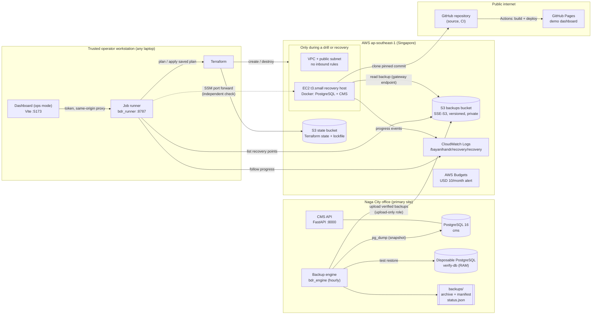
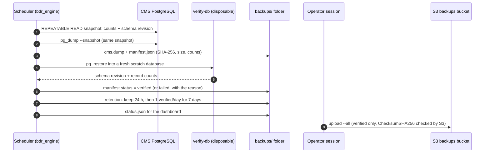
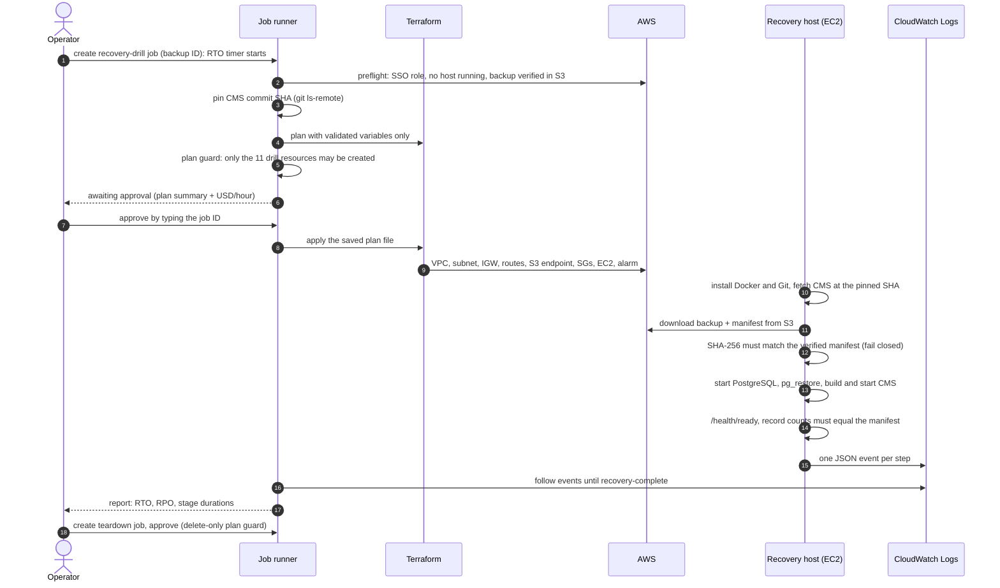

# BayanihanDR architecture

How the three systems fit together, what runs where, and why. For the decisions behind each choice see
[DECISIONS.md](DECISIONS.md) (ADR-001 to ADR-015). For the original requirements see [MASTER_BLUEPRINT.md](MASTER_BLUEPRINT.md).

## 1. The scenario in one paragraph

The fictional **Bicol Farmers Cooperative** in Naga City, Camarines Sur runs its Cooperative Management System
(CMS: members, inventory, transactions) on a server in its office. A typhoon can take that office offline for days.
BayanihanDR takes verified backups every hour, keeps copies **outside the office in Amazon S3 (Singapore)**,
and can rebuild the whole CMS on a temporary AWS server in minutes. The rebuild is driven by Terraform from any
trusted laptop, through an approval-gated job runner. A public demo site shows how it works and the measured results.

## 2. The three systems

| System | Folder | What it is | Where it runs |
|---|---|---|---|
| **A. Cooperative Management System** | [`cooperative-system/`](../cooperative-system/) | FastAPI + PostgreSQL 16 app with synthetic data (1,050 farmers, 26 inventory items, 3,001 transactions) | Office server (Docker Compose); rebuilt on the AWS recovery host during a recovery |
| **B. Recovery engine** | [`backend/`](../backend/), [`terraform/`](../terraform/) | `bdr_engine`: backups, verification, retention, off-site upload. `bdr_runner`: authenticated job runner. Terraform: AWS infrastructure. | Engine: office server (container). Runner and Terraform: any trusted operator workstation |
| **C. Dashboard** | [`frontend/`](../frontend/) | React + Vite + TypeScript. **Demo mode** on GitHub Pages (simulated data plus published real results); **operations mode** locally (real backups, real recovery jobs) | Public: GitHub Pages. Operations: `npm run dev:ops` on the operator workstation |

## 3. Component diagram



**What is always on in AWS:** the two S3 buckets, two IAM roles plus an instance profile, one log group and one
budget. That is the *standby* footprint and costs pennies per month. **What exists only during a drill:** the VPC,
subnet, internet gateway, route table, S3 gateway endpoint, two security groups, the EC2 host and its alarm
(11 resources, about USD 0.034/hour).

## 4. Backup flow (every hour, in the office)



Key properties:
- The counts in the manifest describe **exactly** the archive's contents, because the dump and the counts share one database snapshot.
- A backup is only **verified** after a real restore and a count comparison. A checksum alone is never enough.
- **Off-site upload is manual today**, run from an operator session with 1-hour credentials (ADR-013). This is the
  main open item; see [LESSONS-LEARNED.md](LESSONS-LEARNED.md).

## 5. Recovery flow (a drill or a real disaster)



The recovery host never accepts inbound connections. It reports its progress outward to CloudWatch Logs.
Operators reach it only through **SSM Session Manager**, for example a port forward for independent verification.

## 6. Trust boundaries and failure domains

| Boundary | Protection |
|---|---|
| Office server → AWS | The engine can only **add** objects under `backups/` (role `bdr-recovery-backup-writer`: `s3:PutObject` only). A compromised office server cannot list, read or delete off-site backups, and bucket versioning keeps any overwritten object. |
| Operator → AWS | IAM Identity Center SSO (permission set `BayanihanDR-Developer-V5`): `ReadOnlyAccess` plus a project-scoped inline policy limited to `bayanihandr-*` and `bdr-*` resources in ap-southeast-1, with explicit denies on NAT, Elastic IPs, RDS, load balancers, EKS, IAM users and access keys, and other regions. Sessions last 4 h. |
| Browser → job runner | 127.0.0.1 only, random bearer token, Host and Origin checks, two job types only, strictly validated backup IDs, no free-form input reaches Terraform or a shell. |
| Job runner → Terraform | Fixed command lines, an allowlist of variables with format checks, a plan guard that fails closed, and apply of the **saved** plan only. |
| Recovery host → AWS | Instance role: read backups, write its own log group, SSM. IMDSv2 only with hop limit 1, so containers cannot reach the role credentials. |
| CI → anything | `contents: read`, no secrets, no AWS credentials, actions pinned to commit SHAs. |
| Public site → anything | Static files only. Tests fail the build if any request leaves the site or if job-runner code reaches the bundle. |

**Failure domains.** Recovery needs only:
- the public GitHub repository;
- the S3 backups and the S3 Terraform state;
- an operator's SSO sign-in;
- two small local settings files (`backend.hcl`, `recovery.tfvars`).

**Nothing on the office server is required.** Phase 7 proved this by recovering from a fresh clone with the primary stopped.

## 7. Data stores and formats

| Store | Contents | Format / notes |
|---|---|---|
| `backups/<id>/cms.dump` | One PostgreSQL backup | `pg_dump` custom format. The ID is the UTC start time, for example `20261105T063016Z`. |
| `backups/<id>/manifest.json` | Backup metadata | `format_version` 1: status, SHA-256, size, schema revision, record counts, verification checks, off-site details |
| `backups/events.jsonl`, `status.json` | Engine event log and dashboard snapshot | `status.json` follows the dashboard's TypeScript contracts (schema v1) |
| `s3://bayanihandr-backups-<account>-ap-southeast-1/backups/<id>/` | Off-site copies | Same two files. SSE-S3 encrypted, versioned; current versions kept 30 days, noncurrent 7 days |
| `s3://bayanihandr-tfstate-<account>-ap-southeast-1/` | Terraform state | `recovery/terraform.tfstate`, `bootstrap/terraform.tfstate`, S3 lockfiles |
| `backend/var/jobs/<job-id>/job.json`, `audit.jsonl` | Job records and audit trail | Local to the operator workstation (git-ignored) |
| CloudWatch `/bayanihandr/recovery/recovery`, stream = job ID | Host progress events | JSON per step; kept 7 days |

## 8. Repository map

```text
bayanihan-dr/
├── cooperative-system/      System A: FastAPI CMS, Alembic migrations, seed, tests, docker-compose.yml
│                            (profiles: test, backup, backup-test)
├── backend/
│   ├── bdr_engine/          backup, verify, retention, offsite upload, status, scheduler, CLI
│   ├── bdr_runner/          job runner: model, plan guard, ports (Terraform/AWS/Git), runner, API
│   ├── tests/               engine tests (unit + real PostgreSQL integration)
│   └── runner_tests/        runner tests (fake adapters + HTTP API)
├── terraform/
│   ├── modules/             networking, compute (+ bootstrap template), storage, identity, monitoring
│   ├── environments/recovery/   root module, tests (mocked provider), example backend/tfvars
│   └── bootstrap/           remote-state bucket (state migrated into itself)
├── frontend/                dashboard: src/ (pages, data providers, components), e2e/, e2e-public/, scripts/
├── scripts/validation/      render_bootstrap.py (lint the EC2 user data)
├── docs/                    blueprint, decisions, changelog, runbook, evidence, screenshots
└── .github/                 CI, Pages deploy, live-site check, Dependabot
```
