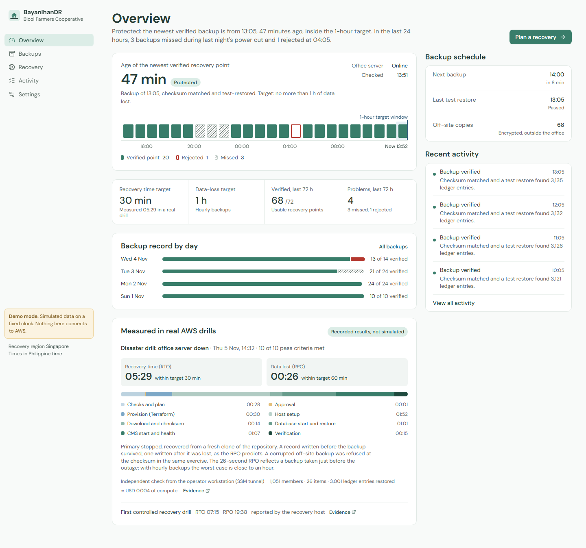
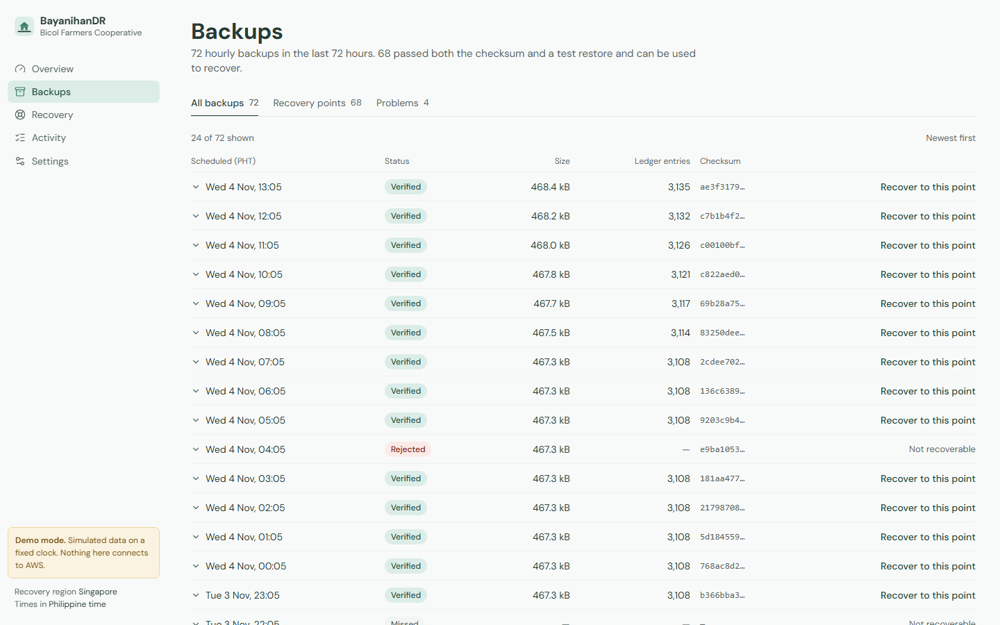
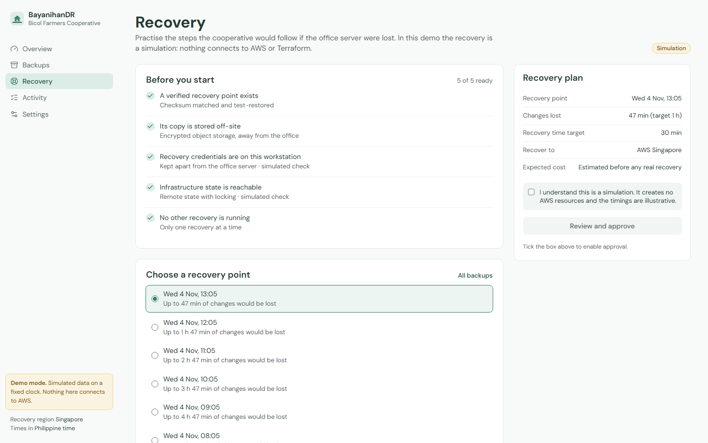
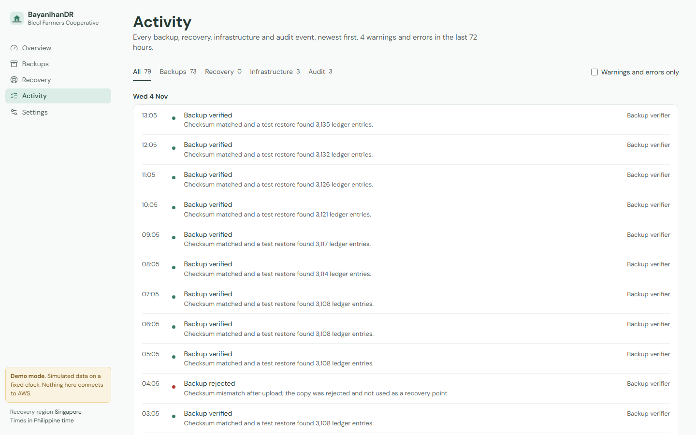

# BayanihanDR documentation

BayanihanDR backs up a sample cooperative management system and restores it in AWS when the office server goes offline. Use this page to find the right guide.

New to the project? Start with the [project overview and showcase](../README.md) for the live demo, recovery results, and local setup commands.

## Start here

| I want to… | Read |
|---|---|
| Understand how the system works | [Architecture](ARCHITECTURE.md): components, diagrams, and data flows |
| Set up the full project | [Setup guide](SETUP.md): a new machine or AWS account |
| Run backups, drills, or recovery | [Operations runbook](RUNBOOK.md): steps, checks, teardown, and troubleshooting |
| See limitations and next steps | [Lessons learned](LESSONS-LEARNED.md) |

## Component guides

Each component has its own setup and testing instructions.

| Component | Guide |
|---|---|
| Sample cooperative application | [Run, seed, and test](../cooperative-system/README.md) |
| Backup and recovery backend | [Backup engine and job runner](../backend/README.md) |
| AWS infrastructure | [Terraform layout, resource lifecycles, and checks](../terraform/README.md) |
| Dashboard | [Demo mode, local operations mode, and tests](../frontend/README.md) |

## Design and reference

| Document | Contents |
|---|---|
| [Security](SECURITY.md) | Threats, controls, accepted risks, and incident response |
| [Cost](COST.md) | Recorded prices, billing evidence, standby and drill costs, and budget alerts |
| [Design decisions](DECISIONS.md) | Architecture decisions and open questions |
| [Changelog](CHANGELOG.md) | Changes made during each project phase |
| [Original blueprint](MASTER_BLUEPRINT.md) | Initial requirements; the PDF is the unchanged baseline |
| [Operator IAM policy](aws/bayanihandr-developer-inline-policy.json) | AWS permissions used by the operator |

## Drill and deployment evidence

These reports contain timestamped, sanitized records. RTO is the time taken to recover; RPO is the age of the recovered data at the time of the outage.

| Phase | Report and result |
|---|---|
| 4 | [Plan review](evidence/phase4-plan-review.md): reviewed real infrastructure plans without applying changes |
| 5 | [First deployment](evidence/phase5-deployment.md): resource inventory, cost checks, and off-site upload and read-back |
| 6 | [First recovery drill](evidence/phase6-recovery-drill.md): recovery in 7 min 15 sec; data age of 19 min 38 sec |
| 7 | [Test plan](evidence/phase7-test-plan.md) and [disaster drill](evidence/phase7-disaster-drill.md): 10/10 checks passed, recovery in 5 min 29 sec, data age of 26 sec, and a corrupted backup rejected |
| 10 | [Final inventory and cost review](evidence/phase10-inventory.md): resource inventory, teardown plan review, and remaining charges |

## Dashboard screenshots

Public demo screenshots captured on 5 November 2026:

| Overview | Backups |
|---|---|
|  |  |

| Recovery | Activity |
|---|---|
|  |  |

See the [phone layout](screenshots/overview-phone.png) too.

To regenerate screenshots, run these commands from the repository root:

```powershell
cd frontend
node scripts/screenshots.mjs
```
